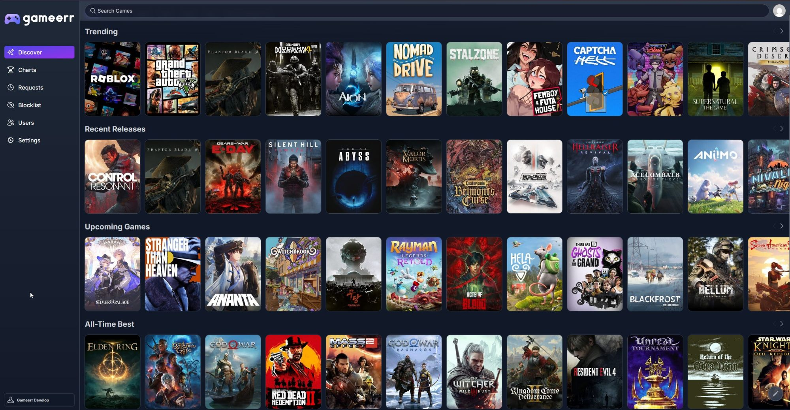
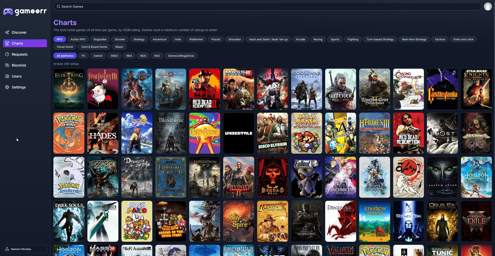
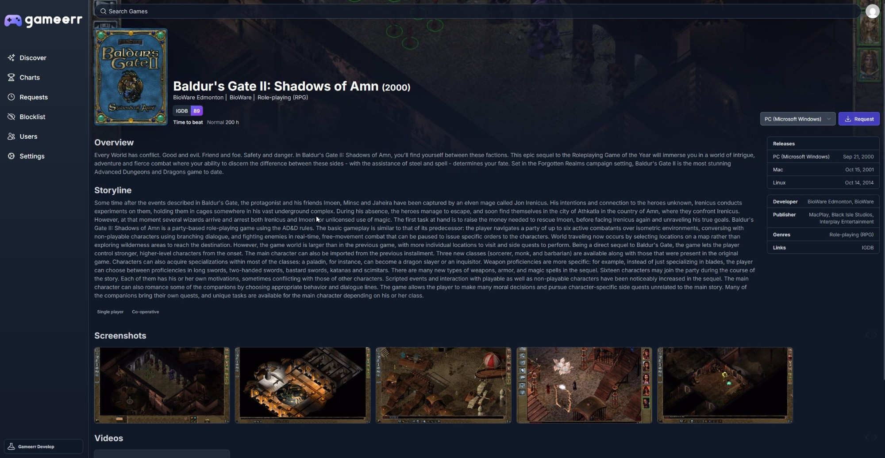

<p align="center">

</p>

**Gameerr** is a self-hosted request and discovery manager for video games. Users pick their platforms, browse recent releases, upcoming and trending games and all-time charts per genre, and request games. An admin approves a request and Gameerr hands it to a download backend: [Questarr](https://github.com/Doezer/Questarr) or [QuestarrNG](https://github.com/snapetech-org/QuestarrNG) for PC, Linux and Mac, [ROMarrNG](https://github.com/snapetech-org/ROMarrNG) for every other platform.

Gameerr is a hard fork of [Seerr](https://github.com/seerr-team/seerr), the movie and TV request manager, and keeps its sign-in, permissions, notifications and settings.

## Features

- **Discover** per platform: recent releases, upcoming games, all-time best and trending.
- **Charts**: the best rated games of all time in 22 categories (RPG, Action RPG, Roguelike, Shooter, Strategy and more), over all platforms or one.
- **Game pages** with screenshots, videos, release dates per platform, scores from IGDB and Steam (and Metacritic where Steam reports it) and the time users took to finish the game.
- **Requests** per game and platform, with approval, quotas and notifications.
- **Fulfillment** through [Questarr](https://github.com/Doezer/Questarr), [QuestarrNG](https://github.com/snapetech-org/QuestarrNG) and [ROMarrNG](https://github.com/snapetech-org/ROMarrNG), with a manual fallback that notifies your admins.
- **Library awareness**: games you own on Steam, in Questarr or in ROMarrNG are marked and cannot be requested twice.
- Sign in with a local account, Jellyfin or Plex. The interface is available in English and German.

## Screenshots

### Discover



### Charts



### Game details



## Quick start

You need an IGDB key. Create an application at the [Twitch developer console](https://dev.twitch.tv/console) and copy its client id and secret.

```bash
git clone https://github.com/letsid/gameerr.git
cd gameerr
cp .env.example .env   # fill in IGDB_CLIENT_ID and IGDB_CLIENT_SECRET
docker compose up -d --build
```

Open <http://localhost:5055>, create the admin account and pick your platforms. Settings, the database and logs live in `./config`, back that folder up.

The published image is `ghcr.io/letsid/gameerr`, built by the release workflow. An Unraid template is in [`unraid/gameerr.xml`](./unraid/gameerr.xml).

## Configuration

Keys are read from the environment, or from a `.env.local` file when you run from source. Keys are never stored in the settings file.

| Variable             | Required | Purpose                                                              |
| -------------------- | -------- | -------------------------------------------------------------------- |
| `IGDB_CLIENT_ID`     | yes      | Twitch application client id for IGDB                                 |
| `IGDB_CLIENT_SECRET` | yes      | Twitch application client secret for IGDB                            |
| `STEAM_API_KEY`      | no       | Steam Web API key, for Steam libraries                               |
| `QUESTARR_URL`       | no       | Address of Questarr or QuestarrNG, for example `http://questarr:5000` |
| `QUESTARR_API_KEY`   | no       | QuestarrNG key with SeerrNG provider access                          |
| `ROMARR_URL`         | no       | Address of ROMarrNG, for example `http://romarr:6868`                |
| `ROMARR_API_KEY`     | no       | ROMarrNG Settings > General > SeerrNG provider key                   |
| `TZ`                 | no       | Time zone, TZ database name                                          |
| `LOG_LEVEL`          | no       | `debug`, `info`, `warn` or `error`, default `info`                   |
| `PORT`, `HOST`       | no       | Listen port (default `5055`) and address                             |
| `CONFIG_DIRECTORY`   | no       | Where settings, database and logs are kept, default `config`         |
| `DB_TYPE` and `DB_*` | no       | Set `DB_TYPE=postgres` plus `DB_HOST`, `DB_PORT`, `DB_USER`, `DB_PASS`, `DB_NAME`, `DB_USE_SSL`, `DB_LOG_QUERIES`, `DB_POOL_SIZE` to use PostgreSQL instead of SQLite. See `compose.postgres.yaml`. |

### Fulfillment backends

Switch each backend on in **Settings > General**, enter its URL and press **Test**. The key comes from the environment.

| Platform                        | Goes to                      |
| ------------------------------- | ---------------------------- |
| PC (Windows), Linux, Mac        | Questarr or QuestarrNG       |
| Every other platform            | ROMarrNG                     |
| Not managed by the backend, or no backend switched on | The request managers are notified, the request stays approved |

[Questarr](https://github.com/Doezer/Questarr) and [QuestarrNG](https://github.com/snapetech-org/QuestarrNG) only acquire PC games, [ROMarrNG](https://github.com/snapetech-org/ROMarrNG) only emulated and console titles. Gameerr talks to them through the SeerrNG provider contract, version 2. It was checked against QuestarrNG 2.1.1 and ROMarrNG 0.14.11, plain Questarr was not tested.

- Gameerr checks the status of handed over requests every 5 minutes and completes them when the backend reports the game as available.
- ROMarrNG runs at most four acquisitions at once. When it is full the request waits and is handed over again on the next check.
- ROMarrNG names systems its own way. Gameerr tries the IGDB slug, the name and the abbreviation of a platform and remembers for 24 hours which one worked.
- ROMarrNG keeps its library without IGDB ids, so owned games are matched by title and system.

### Webhook template variables

The webhook agent replaces these placeholders in the JSON payload (and in the URL when URL variables are on):

`{{notification_type}}`, `{{event}}`, `{{subject}}`, `{{message}}`, `{{image}}`, `{{notifyuser_username}}`, `{{notifyuser_email}}`, `{{notifyuser_avatar}}`, `{{notifyuser_settings_discordIds}}`, `{{notifyuser_settings_telegramChatId}}`, `{{media_igdbid}}`, `{{media_steamappid}}`, `{{media_type}}`, `{{media_status}}`, `{{request_id}}`, `{{request_platform}}`, `{{requestedBy_jellyfinUserId}}`, `{{requestedBy_username}}`, `{{requestedBy_email}}`, `{{requestedBy_avatar}}`, `{{requestedBy_settings_discordIds}}`, `{{requestedBy_settings_telegramChatId}}`.

The keys `{{extra}}`, `{{media}}` and `{{request}}` stand for the matching objects, or `null` when the notification has none.

## Data sources

- Game metadata, covers, platforms, release dates, ratings, popularity and times to beat come from [IGDB](https://www.igdb.com/), used under its free non-commercial terms. Gameerr is not affiliated with or endorsed by IGDB or Twitch.
- Steam libraries and Steam scores come from the Steam Web API and store API.
- Metacritic is not scraped. A Metacritic score shows only where Steam reports it for a game.

## Development

```bash
pnpm install
cp .env.example .env.local
pnpm dev
```

Useful commands: `pnpm test`, `pnpm lint`, `pnpm typecheck`, `pnpm build`, `pnpm i18n:extract`. `compose.dev.yaml` and `compose.postgres.yaml` start a development container. The API is described in [`gameerr-api.yml`](./gameerr-api.yml).

## Branding

The logo set in `public/` is generated by `node bin/generate-brand-assets.mjs .`.

## License

MIT. See [LICENSE](./LICENSE), which keeps the copyright notice of the Seerr project.
